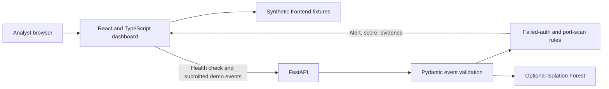

# SentinelForge

**AI-Powered Intelligent SOC Monitoring and Alert Prioritization System**

SentinelForge is a security operations dashboard and explainable detection API. It ships with synthetic events and alerts so analysts can explore alert triage, evidence, risk scoring, and investigation workflows locally.

> **Demo mode:** this project does not ingest real security telemetry, persist alerts, call an LLM, or query an external threat-intelligence service. Dashboard metrics, charts, reputation examples, and seeded records are synthetic. The detection API analyzes only the events submitted to it.

## Problem statement

Security analysts need to review large volumes of activity, identify suspicious patterns, and understand why a detection was raised. SentinelForge demonstrates a compact workflow for exploring synthetic security events, prioritizing alerts, and inspecting the evidence behind deterministic detections.

## Project objectives

- Present a clear SOC-style overview of synthetic events and alerts.
- Let analysts search and filter alerts and inspect their evidence.
- Demonstrate explainable failed-authentication and port-scan detections with bounded risk scores.
- Provide a small, validated API boundary that can later be connected to real ingestion and persistence systems.
- Keep demo behavior and unconfigured integrations clearly identified.

## Implemented features

### Dashboard

- Responsive dark SOC dashboard with Overview, Alerts, Event Explorer, Incident Management, AI Investigation, Detection Rules, Threat Intelligence, and Settings views.
- Seeded synthetic alerts and normalized event examples, including SSH failures, successful logins, suspicious HTTP requests, and connection attempts.
- Search and filters on the Alerts and Event Explorer pages.
- Alert detail panel with evidence, status transitions, and analyst notes. These changes are held in browser memory and reset when the app is reloaded.
- **Run Demo Detection** submits six synthetic failed SSH login events from `198.51.100.23` to the configured API. Returned alerts are added to the table and labeled as API-generated demo data; seeded alerts remain labeled separately.
- Loading, empty, API error, and detection result feedback.

Several dashboard values, charts, reputation indicators, and operational status examples are static demo content. Detection-rule controls, preferences, and incident workflows are frontend demonstrations; they do not configure backend rules or persist changes.

### API and detection engine

- `GET /health` reports API health and whether optional integrations are configured.
- `POST /api/v1/detections/analyze` validates submitted events and runs deterministic detection rules for repeated failed authentication and port-scanning patterns.
- Detection responses include the matching rule, severity, risk score, source and destination IPs, usernames, and evidence signals.
- Risk scores use bounded evidence contributions and are capped at 100.
- `POST /api/v1/detections/anomalies` provides optional Isolation Forest scoring when enough distinct event sources are supplied.
- `GET /api/v1/ai/status` reports configuration status. It does not call an LLM.

## Planned features

These are **not implemented** in the current project:

- Real log ingestion, streaming connectors, and production SIEM integrations.
- PostgreSQL-backed event, alert, incident, note, and audit persistence. SQLAlchemy and PostgreSQL driver dependencies are present, but the application does not currently use them for storage.
- OIDC/JWT token verification, real user identity, and server-side role authorization.
- Persistent, configurable detection rules and alert workflow changes.
- LLM-based investigation summaries or recommendations.
- External threat-intelligence enrichment.
- Production telemetry, rate limiting, deployment configuration, and operational hardening.

## Technology stack

| Layer | Technologies |
|---|---|
| Frontend | React 18, TypeScript, Vite |
| UI and charts | Lucide React, Recharts, CSS |
| API | Python, FastAPI, Pydantic, Uvicorn |
| Detection | Python rule logic, scikit-learn Isolation Forest, NumPy |
| Tests | Python standard-library `unittest` |
| Future persistence dependencies | SQLAlchemy and psycopg are listed in backend requirements; database persistence is not wired up. |

## System architecture



The frontend can run without the backend and displays its seeded data locally. When configured, it checks the API health route and can submit the Alerts page demo events for analysis. The API has no database or durable state; it analyzes each request and returns a response.

For implementation details and trust boundaries, see [docs/architecture.md](docs/architecture.md).

## Project structure

```text
.
├── backend/
│   ├── app/
│   │   ├── __init__.py
│   │   └── main.py              # FastAPI application, schemas, routes, and detection logic
│   ├── tests/
│   │   ├── __init__.py
│   │   └── test_detections.py   # Detection and health checks
│   └── requirements.txt         # Python dependencies
├── docs/
│   └── architecture.md          # Data flow, trust boundaries, production roadmap
├── src/
│   ├── App.tsx                  # Dashboard pages and interactions
│   ├── api.ts                   # Configurable frontend API boundary
│   ├── data.ts                  # Synthetic alerts, events, and timeline data
│   ├── main.tsx                 # React entry point
│   ├── status.css
│   ├── styles.css
│   └── vite-env.d.ts
├── .env.example                 # Example local configuration; contains placeholders
├── index.html
├── package.json
├── package-lock.json
├── tsconfig.app.json
├── tsconfig.json
└── vite.config.ts
```

## Requirements

- Windows PowerShell
- Python 3.10 or later
- Node.js 20 or later with npm

Run the commands below from the project root directory.

## Installation

### Backend environment

Create and activate a Python virtual environment, install backend dependencies, and optionally create a local `.env` from the example file:

```powershell
python --version
python -m venv .venv
.\.venv\Scripts\Activate.ps1
python -m pip install --upgrade pip
python -m pip install -r backend\requirements.txt
if (-not (Test-Path .env)) { Copy-Item .env.example .env }
```

The demo API uses local defaults and does not need credentials. Keep real credentials out of source files and never place secrets in frontend build-time variables.

If PowerShell prevents virtual-environment activation, use its Python executable directly:

```powershell
.\.venv\Scripts\python.exe -m pip install -r backend\requirements.txt
```

### Frontend dependencies

Open a second PowerShell terminal at the project root and install the packages listed by `package.json`:

```powershell
npm install
```

## Start the backend

From the project root, with the virtual environment active:

```powershell
uvicorn backend.app.main:app --reload --host 127.0.0.1 --port 8000
```

Or, without activating the environment:

```powershell
.\.venv\Scripts\python.exe -m uvicorn backend.app.main:app --reload --host 127.0.0.1 --port 8000
```

The API does not define a root (`/`) route, so `http://127.0.0.1:8000/` returns FastAPI's normal `404 Not Found` response. Use these routes instead:

- Health: [http://127.0.0.1:8000/health](http://127.0.0.1:8000/health)
- Interactive API documentation: [http://127.0.0.1:8000/docs](http://127.0.0.1:8000/docs)
- Alternative API documentation: [http://127.0.0.1:8000/redoc](http://127.0.0.1:8000/redoc)

## Start the frontend

The frontend uses synthetic fixtures without an API URL. To enable backend health checks and the Alerts page's **Run Demo Detection** action, set the backend base URL in `.env.local` from the project root:

```powershell
@'
VITE_API_BASE_URL=http://127.0.0.1:8000
'@ | Set-Content .env.local
npm run dev -- --host 127.0.0.1
```

Open the local address printed by Vite. Restart Vite after changing `.env.local`. This URL is public browser configuration; do not put API keys, passwords, or other secrets in `VITE_*` variables.

With the backend running and the frontend configured, open **Alerts** and click **Run Demo Detection**. The API should return a repeated-authentication-failures detection for the submitted synthetic events. The UI only adds alerts present in the API response.

## API endpoints

| Method | Path | Description |
|---|---|---|
| `GET` | `/health` | Health and demo/integration configuration status. |
| `POST` | `/api/v1/detections/analyze` | Validate and analyze an event batch using the failed-authentication and port-scan rules. |
| `POST` | `/api/v1/detections/anomalies` | Optional Isolation Forest scoring for an event batch. Results are unavailable when dependencies are missing or fewer than five distinct sources are present. |
| `GET` | `/api/v1/ai/status` | Reports whether LLM configuration values are present; no model request is made. |

The detection request schema and interactive request forms are available at `/docs`. Analysis events require a timestamp, source IP, username, event type, and outcome. Optional fields include destination IP, destination port, asset, and metadata.

## Tests and production build

Run the existing backend unit tests:

```powershell
.\.venv\Scripts\python.exe -m unittest discover -s backend\tests -v
```

Check frontend TypeScript types and create a production build:

```powershell
npm run typecheck
npm run build
```

There is currently no separate frontend automated test suite. `npm run build` runs the TypeScript check before Vite creates the production bundle.

## Screenshots

Screenshots have not been added yet. Capture the running demo and add images at the paths below when available:

| View | Placeholder path |
|---|---|
| Overview dashboard | `docs/screenshots/overview.png` |
| Alerts and detection result | `docs/screenshots/alerts.png` |
| Alert evidence and investigation panel | `docs/screenshots/investigation.png` |

## Security and demo limitations

- `AUTH_ENABLED` is disabled for local demo use. The current `analyst_guard` is an integration seam, not authentication: if enabled, requests return `501` until real token verification is implemented.
- CORS is configured for local development origins by default. Configure trusted origins before any deployment; CORS does not provide authentication.
- LLM, threat-intelligence, and database settings are not connected to functioning provider or persistence implementations.
- Do not use this demo to monitor production systems or submit sensitive telemetry.

## Roadmap

1. Implement OIDC/JWT validation and server-side role/tenant authorization.
2. Add database models, migrations, persistence, retention, and audit history.
3. Add authenticated event ingestion, production connectors, schema versioning, deduplication, and backpressure.
4. Persist alert state, analyst notes, incidents, and versioned detection rules.
5. Add tested LLM and threat-intelligence provider adapters with redaction, provenance, timeouts, and clear degraded states.
6. Add frontend integration tests, API integration tests, operational metrics, deployment configuration, and production hardening.
